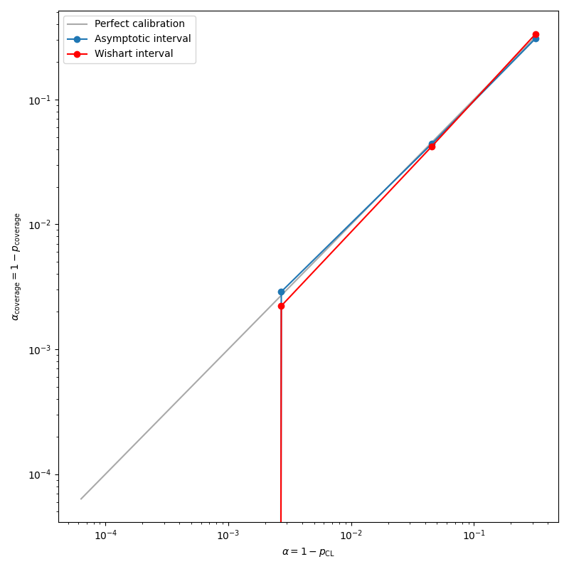

# covariance_calculators

[](https://github.com/rreece/covariance_calculators/actions)

Implementations of covariance estimators and confidence intervals


## Introduction

This package provides numerically stable, online (streaming) estimators
for means, covariance matrices, and correlation matrices,
along with methods for computing confidence intervals on the covariance estimates.

Estimators included:

-   `OnlineCovariance` - Welford's one-pass algorithm for incremental mean and covariance estimation, with support for merging independent estimators
-   `EMACovariance` - Exponential moving average covariance, parameterized by alpha, halflife, or span, and bias-corrected by default (`bias=False`)
-   `SMACovariance` - Simple moving average covariance over a fixed rolling window

All estimators support a `geometric=True` mode that applies a log transform
to observations, suitable for multiplicative processes like financial returns,
and a `frequency` parameter for annualizing results (e.g. `frequency=252` for daily data).
Geometric mode requires returns greater than -1, and `add` raises a `ValueError` otherwise.

Confidence interval methods for the sample covariance matrix include:

-   `asymptotic` - Normal approximation using the Wishart variance formula
-   `chi2` - Exact chi-squared intervals for variances, with `asymptotic` intervals for covariances
-   `wishart` - Monte Carlo sampling from the Wishart distribution
-   `bootstrap` - Bootstrap resampling
-   `parametric_mc` - Parametric Monte Carlo from a fitted normal

Confidence intervals for the precision matrix use `calc_precision_intervals`,
which samples from the inverse Wishart distribution, and is bias-corrected by default (`bias=False`).
Except for `chi2` variances, these methods are large-sample approximations;
see [Coverage at small sample sizes](#coverage-at-small-sample-sizes).


## Basic usage

```python
import numpy as np
from covariance_calculators.estimators import OnlineCovariance
from covariance_calculators.intervals import calc_covariance_intervals

## Generate toy data: 500 samples from a 3d normal distribution
rng = np.random.default_rng(42)
true_cov = np.array([[1.0, 0.5, 0.2],
                     [0.5, 2.0, 0.3],
                     [0.2, 0.3, 1.5]])
L = np.linalg.cholesky(true_cov)
data = rng.standard_normal((500, 3)) @ L.T

## Stream data through the online estimator
oc = OnlineCovariance(order=3)
for row in data:
    oc.add(row)

print("mean =")
print(oc.mean)
print("cov =")
print(oc.cov)
print("corr =")
print(oc.corr)

## Compute 95% confidence intervals on the covariance estimate
cov, ci_lower, ci_upper = calc_covariance_intervals(
    data=data,
    confidence_level=0.95,
    method="asymptotic",
)
print("ci_lower =")
print(ci_lower)
print("ci_upper =")
print(ci_upper)
```

Example output:

```
mean =
[ 0.0021 -0.0354 -0.0472]
cov =
[[1.1017 0.6671 0.2329]
 [0.6671 2.0806 0.3757]
 [0.2329 0.3757 1.4245]]
corr =
[[1.     0.4406 0.1859]
 [0.4406 1.     0.2182]
 [0.1859 0.2182 1.    ]]
ci_lower =
[[0.965  0.5219 0.1211]
 [0.5219 1.8224 0.2211]
 [0.1211 0.2211 1.2478]]
ci_upper =
[[1.2385 0.8122 0.3447]
 [0.8122 2.3388 0.5303]
 [0.3447 0.5303 1.6013]]
```


## Setup and running tests

To use the package in another project, install it from the repository root:

```bash
pip install .
```

For development, create and activate a virtual environment:

```bash
source setup.sh
```

This will create a `.venv` virtualenv (if one doesn't already exist),
install the dependencies from `requirements.txt`, and add the parent
directory to your `PYTHONPATH`.

Run the tests:

```bash
make test
```

You can also run the linter with:

```bash
make lint
```


## Coverage tests

Shows that the confidence intervals are well calibrated for 1000 samples
at 1, 2, 3, and 4 $\sigma$ confidence levels.
`make test` checks this at 1, 2, and 3 $\sigma$ for `asymptotic`, and at 1 and 2 $\sigma$ for `wishart`,
because the number of toys in the test cannot resolve the higher levels.




## Online mean and covariance estimation


### Sample mean and covariance

Mean:

```math
\mu_{i} = \mathbb{E}[x_{i}]
```

Covariance:

```math
\Sigma_{ij} = \mathrm{cov}(x_{i}, x_{j}) = \mathbb{E}[(x_{i} - \mu_{i})(x_{j} - \mu_{j})] = \mathbb{E}[x_{i} x_{j}] - \mu_{i} \mu_{j}
```

Sample mean:

```math
\bar{x}_{i} = \frac{1}{n} \sum_{k=1}^{n} x_{ik}
```

Sample covariance:

```math
V_{ij} = \frac{1}{n-1} \sum_{k=1}^{n} (x_{ik} - \bar{x}_{i}) ( x_{jk} - \bar{x}_{j} )
```

Scatter matrix:

```math
S = \sum_{k=1}^{n} \left( \vec{x}_{k} - \vec{\mu} \right) \left( \vec{x}_{k} - \vec{\mu} \right)^\intercal
```

```math
V = \frac{1}{n-1} S
```


### Online mean and covariance

This discusses how one can calculate a continuously updated covariance
estimate one data sample at a time.

Univariate central moments:

```math
\mu_{p} = \mathbb{E}\left[(x - \mu_{1})^{p}\right]
```

```math
M_{p} = \sum_{i}^{n} (x_i - \mu_{1})^{p}
```

```math
\mu_{p} = \frac{M_{p}}{n} \,, \qquad \mu = \frac{M_{1}}{n} \,, \qquad \sigma^2 = \frac{M_{2}}{n}
```

Online mean:

```math
\delta \equiv x_n - \mu_{n - 1}
```

```math
\hat{\mu}_{n} = \mu_{n-1} + \frac{\delta}{n}
```

Online variance:

```math
S_{n} = M_{2,n}
```

```math
\hat{\sigma}^2 = \frac{S_{n}}{n-1}
```

where the $n-1$ includes Bessel's correction for sample variance.

Incrementally,

```math
S_{n} = S_{n-1} + (x_n - \mu_{n - 1}) (x_n - \mu_n)
```

Note that for $n > 1$,

```math
(x_n - \mu_n) = \frac{n-1}{n} (x_n - \mu_{n - 1})
```

Therefore,

```math
S_{n} = S_{n-1} + \frac{n-1}{n} (x_n - \mu_{n - 1}) (x_n - \mu_{n - 1})
```

```math
S_{n} = S_{n-1} + \frac{n-1}{n} \delta^2 = S_{n-1} + \delta \left( \delta - \frac{\delta}{n} \right)
```

Online covariance (Welford algorithm):

```math
C_{n}(x, y) = C_{n-1} + (x_n - \bar{x}_{n - 1}) (y_n - \bar{y}_n) = C_{n-1} + \delta_{x} \delta_{y}^\prime
```

```math
C_{n}(x, y) = C_{n-1} + \frac{n-1}{n} (x_n - \bar{x}_{n - 1}) (y_n - \bar{y}_{n - 1}) = C_{n-1} + \frac{n-1}{n} \delta_{x} \delta_{y}
```

```math
\hat{V}_{xy} = \frac{C_{n}(x, y)}{n-1}
```

Matrix form:

```math
C_{n} = C_{n-1} + \left( \vec{x}_{n} - \vec{\mu}_{n-1} \right) \left( \vec{x}_{n} - \vec{\mu}_{n} \right)^\intercal = C_{n-1} + \vec{\delta} \: \vec{\delta^\prime}^\intercal
```

```math
C_{n} = C_{n-1} + \frac{n-1}{n} \left( \vec{x}_{n} - \vec{\mu}_{n-1} \right) \left( \vec{x}_{n} - \vec{\mu}_{n-1} \right)^\intercal = C_{n-1} + \frac{n-1}{n} S(\vec{x}_{n}, \vec{\mu}_{n-1})
```

```math
\hat{V} = \frac{C_{n}}{n-1}
```

Note that the update term for the online covariance is a term in a scatter matrix, $S$,
using the currently observed data, $x_{n}$, and the previous means, $\mu_{n-1}$.
But also note that the $\delta \delta^\prime$ form is also
convenient because it comes naturally normalized and can be readily generalized for weighting.

Weighted mean:

```math
\hat{\mu}_{n} = \mu_{n-1} + \frac{w_{n,n}}{W_n} \delta = \mu_{n-1} + \frac{w_{n,n}}{W_n} (x_n - \mu_{n - 1})
```

where

```math
W_{n} = \sum_{i=1}^{n} w_{n,i}
```

Weighted covariance:

```math
C_{n} = \frac{W_n - w_{n,n}}{W_{n-1}} C_{n-1} + w_{n,n} \left( x_{n} - \bar{x}_{n-1} \right) \left( y_{n} - \bar{y}_{n} \right)
```

```math
C_{n} = \frac{W_n - w_{n,n}}{W_{n-1}} C_{n-1} + w_{n,n} \left( \vec{x}_{n} - \vec{\mu}_{n-1} \right) \left( \vec{x}_{n} - \vec{\mu}_{n} \right)^\intercal
```

where

```math
\hat{V} = \frac{C_{n}}{W_{n}}
```

Exponential-weighted mean:

```math
\alpha = 1 - \mathrm{exp}\left( \frac{-\Delta{}t}{\tau} \right) \simeq \frac{\Delta{}t}{\tau}
```

```math
\hat{\mu}_{n} = \mu_{n-1} + \alpha (x_{n} - \mu_{n-1}) = (1 - \alpha) \mu_{n-1} + \alpha x_{n}
```

Exponential-weighted covariance:

```math
C_{n} = (1 - \alpha) C_{n-1} + \alpha \left( x_{n} - \bar{x}_{n-1} \right) \left( y_{n} - \bar{y}_{n} \right)
```

```math
C_{n} = (1 - \alpha) C_{n-1} + \alpha \left( \vec{x}_{n} - \vec{\mu}_{n-1} \right) \left( \vec{x}_{n} - \vec{\mu}_{n} \right)^\intercal
```

where by summing a geometric series, one can show that for exponential weighting, $W_{n} = 1$,
so $C_{n}$ is the weighted covariance.


### Bias correction

The weighted covariance measures spread around a weighted mean that includes the
same observations, so like dividing by $n$ instead of $n-1$, it is biased low.
For i.i.d. data with normalized weights,

```math
\mathbb{E}[C_{n}] = V \left( 1 - \sum_{i=1}^{n} w_{n,i}^2 \right)
```

The sum of squared weights can be updated online:

```math
\sum_{i=1}^{n} w_{n,i}^2 = (1 - \alpha)^2 \sum_{i=1}^{n-1} w_{n-1,i}^2 + \alpha^2
```

and the unbiased estimator, the analog of Bessel's correction, is

```math
\hat{V} = \frac{C_{n}}{1 - \sum_{i} w_{n,i}^2}
```

At steady state $\sum_{i} w_{n,i}^2 = \alpha / (2 - \alpha)$, and with
$\alpha = 2 / (\mathrm{span} + 1)$ this is $1 / \mathrm{span}$,
so the correction is exactly $\mathrm{span} / (\mathrm{span} - 1)$.

`EMACovariance` applies this correction by default.
With `bias=True` it returns $C_{n}$, which matches
`pandas.Series.ewm(adjust=False).var(bias=True)`.


## Theory of confidence intervals

### Cochran's theorem

For $n$ i.i.d. samples from a normal distribution, $x_i \sim N(\mu, \sigma^2)$,
Cochran's theorem gives the sampling distribution of the MLE variance estimator:

```math
\frac{n \hat{\sigma}^2}{\sigma^2} \sim \chi^{2}_{n-1}
```

where the MLEs for a normal distribution are

```math
\hat{\mu} = \frac{1}{n} \sum_{i=1}^{n} x_i
```

and

```math
\hat{\sigma}^2 = \frac{1}{n} \sum_{i=1}^{n} ( x_i - \hat{\mu} )^2
```

Note the unbiased sample variance is

```math
s^2 = \frac{1}{(n-1)} \sum_{i=1}^{n} ( x_i - \hat{\mu} )^2
```

So

```math
s^2 = \frac{n}{(n-1)} \hat{\sigma}^2
```

and

```math
\frac{(n-1) s^2}{\sigma^2} \sim \chi^{2}_{n-1}
```


### Quantiles to p-values

Cumulative distribution function:

```math
F(y) = \int_{-\infty}^{y} f(x) dx
```

```math
\bar{F}(y) = 1 - F(y) = \int_{y}^{\infty} f(x) dx
```

$p$-value from test statistic $q$:

```math
p = 1 - \alpha = \int_{-\infty}^{q_{\alpha}} f(q) dq = F(q(\alpha))
```

Critical value of test statistic for a given $p$-value:

```math
q_{\alpha} = F^{-1}(1 - \alpha) = \mathrm{ppf}(1 - \alpha)
```

Two sided:

```math
1 - \alpha = \int_{q_{\alpha}^\mathrm{lower}}^{q_{\alpha}^\mathrm{upper}} f(q) dq
```

```math
1 - \frac{\alpha}{2} = \int_{-\infty}^{q_{\alpha}^\mathrm{upper}} f(q) dq = F(q_{\alpha}^\mathrm{upper})
```

```math
1 - \frac{\alpha}{2} = \int_{q_{\alpha}^\mathrm{lower}}^{\infty} f(q) dq = \bar{F}(q_{\alpha}^\mathrm{lower}) = 1 - F(q_{\alpha}^\mathrm{lower})
```

```math
q_{\alpha}^\mathrm{upper} = F^{-1}(1 - \frac{\alpha}{2}) = \mathrm{ppf}(1 - \frac{\alpha}{2})
```

```math
q_{\alpha}^\mathrm{lower} = F^{-1}(\frac{\alpha}{2}) = \mathrm{ppf}(\frac{\alpha}{2})
```


### Confidence intervals for sample mean

Sample mean:

```math
\bar{x} = \frac{1}{n} \sum_{i=1}^{n} x_i
```

Variance of sample mean:

```math
\mathrm{Var}(\bar{x}) = \mathrm{Var}\left( \frac{1}{n} \sum_{i=1}^{n} x_i \right) = \frac{1}{n^2} \sum_{i=1}^{n} \mathrm{Var}(x_i) = \frac{1}{n^2} \sum_{i=1}^{n} \sigma^2 = \frac{\sigma^2}{n} 
```

Asymptotically assuming the errors are normally distributed,
we have a frequentist confidence interval:

```math
\mu = \hat{\mu} \pm z_{\alpha} \sigma_{\hat{\mu}} = \bar{x} \pm z_\alpha \frac{\hat{\sigma}}{\sqrt{n}} \qquad \mathrm{at}~(1-\alpha)~\mathrm{CL}
```


### Wishart distribution

Scatter matrix:

```math
S = \sum_{i=1}^{n} ( x_i - \bar{x} ) ( x_i - \bar{x} )^\intercal
```

If the mean is known to be zero, $X \sim N_{p}(0, V)$, then $S \sim W_{p}(V, n)$.

If the mean is estimated from the data, $X \sim N_{p}(\mu, V)$, then $S \sim W_{p}(V, n-1)$.

If $p=1$ and $V=1$, then $W_{1}(1, n) = \chi^{2}_{n}$.

Variance of the $(i,j)$ element of $W \sim W_{p}(V, n)$:

```math
\mathrm{Var}(W_{ij}) = n \cdot ( V_{ii} V_{jj} + V_{ij}^{2} )
```


### Confidence intervals for sample covariance

Variance of the scatter matrix elements (from the Wishart with $n-1$ degrees of freedom):

```math
\mathrm{Var}(S_{ij}) = (n-1) ( V_{ii} V_{jj} + V_{ij}^{2} )
```

Sample covariance matrix:

```math
\hat{V} = \frac{1}{n-1} S
```

Variance of sample covariance matrix:

```math
\mathrm{Var}(\hat{V}_{ij}) = \frac{1}{(n-1)^2} \mathrm{Var}(S_{ij}) = \frac{1}{n-1} ( \hat{V}_{ii} \hat{V}_{jj} + \hat{V}_{ij}^{2} )
```

Asymptotically assuming the errors are normally distributed:

```math
\hat{\sigma}_{ij} = \sqrt{\frac{1}{n-1} ( \hat{V}_{ii} \hat{V}_{jj} + \hat{V}_{ij}^{2} )}
```

and we have a frequentist confidence interval:

```math
V_{ij} = \hat{V}_{ij} \pm z_{\alpha} \hat{\sigma}_{ij}
```

at a confidence level picked by the two-sided $z$ score:

```math
z_{\alpha} = \Phi^{-1}\left(1 - \frac{\alpha}{2}\right)
```

because

```math
\Phi(z_{\alpha}) = \int_{-\infty}^{z_{\alpha}} \phi(x) dx  = 1 - \frac{\alpha}{2}
```

where

```math
\phi(x) = \frac{1}{\sqrt{2\pi}} e^{-x^2/2}
```

This is what is implemented for `method="asymptotic"`.


Instead of using quantiles of the normal distribution we could use the quantiles of the Wishart distribution more directly.

```math
V_{ij} = \hat{V}_{ij} \pm \Delta_{ij}^{\alpha}
```

where $\Delta_{ij}^{\alpha}$ are determined by the quantiles of the Wishart distribution, $Q_{ij}$.

```math
1 - \frac{\alpha}{2} = F_{W}(Q^\mathrm{upper}; \hat{V}, n-1)
```

```math
Q^\mathrm{upper} = F_{W}^{-1}(1 - \frac{\alpha}{2}; \hat{V}, n-1)
```

```math
Q^\mathrm{lower} = F_{W}^{-1}(\frac{\alpha}{2}; \hat{V}, n-1)
```

```math
Q_{ij}^\mathrm{lower} < V_{ij} < Q_{ij}^\mathrm{upper} \qquad \mathrm{at~approximately}~(1-\alpha)~\mathrm{CL}
```

This is what is implemented for `method="wishart"`.


### Coverage at small sample sizes

These intervals plug the estimate $\hat{V}$ in for the unknown $V$, so they are only
approximately calibrated. The approximation is good for large $n$, but variances are
under-covered at small $n$. The distribution of a variance estimate is skewed
to the right, and the true variance tends to fall above the interval.
Measured for a nominal 95% interval on a diagonal element with `method="asymptotic"`:

| $n$  | Coverage | True value above the interval |
|------|----------|-------------------------------|
| 10   | 86%      | 14%                           |
| 30   | 92%      | 8%                            |
| 100  | 94%      | 5.4%                          |
| 1000 | 95%      | 3.5%                          |

`method="wishart"` behaves about the same.

For normal data, variances have an exact interval, because

```math
\frac{(n-1) \hat{V}_{ii}}{V_{ii}} \sim \chi^{2}_{n-1}
```

Inverting this gives

```math
\frac{(n-1) \hat{V}_{ii}}{\chi^{2}_{1-\alpha/2}} < V_{ii} < \frac{(n-1) \hat{V}_{ii}}{\chi^{2}_{\alpha/2}} \qquad \mathrm{at}~(1-\alpha)~\mathrm{CL}
```

where $\chi^{2}_{q}$ is the $q$ quantile of $\chi^{2}_{n-1}$.
This is what is implemented for the diagonal elements with `method="chi2"`.
Covariances have no similarly simple exact interval,
so the off-diagonal elements use the same bounds as `method="asymptotic"`.
The interval is only exact for normal data. Data with fatter tails, like most financial returns,
will have lower coverage. Of the methods here, only `bootstrap` does not assume normality.

The `wishart`, `bootstrap`, and `parametric_mc` methods estimate quantiles from a finite number of draws,
set by `n_draws`. The tail beyond a bound holds a fraction $\alpha/2$ of the draws,
so at 4 $\sigma$, where $\alpha/2 \simeq 3 \times 10^{-5}$, the default draws
leave less than one sample in each tail. High confidence levels need a larger `n_draws`.


### Bias of the precision estimate

The inverse $\hat{V}^{-1}$ of the unbiased covariance estimate is not itself unbiased.
With $\nu = n - 1$ degrees of freedom and $p$ features,

```math
\mathbb{E}[\hat{V}^{-1}] = \frac{\nu}{\nu - p - 1} V^{-1}
```

so the unbiased estimator of the precision is

```math
\hat{P} = \frac{\nu - p - 1}{\nu} \hat{V}^{-1}
```

`calc_precision_intervals` returns $\hat{P}$ by default, and centers its intervals on it.
This also improves the coverage. Measured for a nominal 95% interval on the diagonal elements:

| $p$ | $n$ | Coverage of $\hat{V}^{-1}$ (`bias=True`) | Coverage of $\hat{P}$ (default) |
|-----|------|-----|-----|
| 3   | 15   | 90.5% | 94.5% |
| 3   | 100  | 94.3% | 94.6% |
| 10  | 20   | 67.9% | 94.7% |
| 10  | 200  | 91.8% | 94.5% |

Note that $\hat{P}$ is not the exact inverse of $\hat{V}$.


## References

-   Welford, B.P. (1962). Note on a method for calculating corrected sums of squares and products.
-   Cowan, G. (1998). *Statistical Data Analysis*.
-   James, F. (2006). *Statistical Methods in Experimental Particle Physics* (2nd ed.).
-   P&eacute;bay, P. (2008). [Formulas for robust, one-pass parallel computation of covariances and arbitrary-order statistical moments](https://www.osti.gov/servlets/purl/1028931).
-   Finch, T. (2009). [Incremental calculation of weighted mean and variance](https://citeseerx.ist.psu.edu/document?repid=rep1&type=pdf&doi=5f77d0594f66e49cc0e8c2b8177ead33b7137183).
-   Meng, X. (2015). [Simpler online updates for arbitrary-order central moments](https://arxiv.org/abs/1510.04923).
-   P&eacute;bay, P. et al. (2016). [Numerically stable, scalable formulas for parallel and online computation of higher-order multivariate central moments with arbitrary weights](https://link.springer.com/article/10.1007/s00180-015-0637-z).
-   Heins, A. (2024). [Confidence intervals for Wishart random matrices](https://adamheins.com/blog/wishart-confidence-intervals).
-   Reece, R. (2026). *[Finance Notes](https://rreece.github.io/finance-notes/)*.
-   [Algorithms for calculating variance](https://en.wikipedia.org/wiki/Algorithms_for_calculating_variance). *Wikipedia*.
-   [Cochran's theorem](https://en.wikipedia.org/wiki/Cochran%27s_theorem). *Wikipedia*.
-   [Covariance matrix](https://en.wikipedia.org/wiki/Covariance_matrix). *Wikipedia*.


## Author

Ryan Reece ([@rreece](https://github.com/rreece))         
Created: February 17, 2025       

